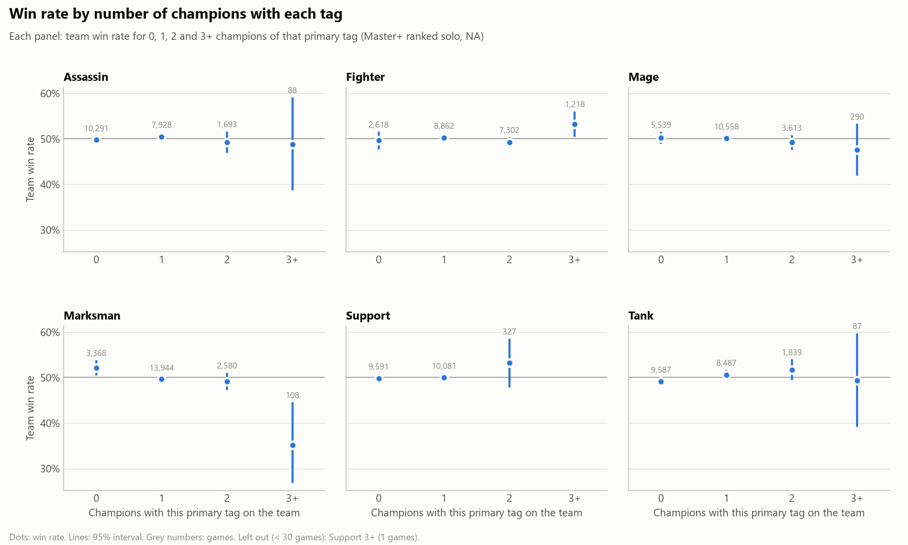

# league_of_stats

League of Legends data analysis, for fun and for practice. It pulls high-elo ranked matches from the Riot API,
joins them to champion data from Data Dragon, and analyzes win rates.

## Findings so far

Based on 10,000 NA Master, Grandmaster and Challenger ranked solo matches, 20 Oct to 3 Nov 2026 (patch 16.21).

| Analysis | Question | Answer |
|---|---|---|
| [Team composition](analyses/team_comps/README.md) | Do some mixes of champion classes win more? | Barely. Stacking marksmen hurts (3+ marksmen win 35%), and red side (52.7%) matters more than any class. |
| [Team stats](analyses/team_stats/README.md) | Do teams whose champions have better stats win more? | No. Every stat moves win rate by about 1 point or less, at levels 6, 12 and 18 alike. |
| [Champion pairs and trios](analyses/champion_groups/README.md) | Which champions win most together? | No clear evidence of pair synergy once each champion's own strength is accounted for. Trios are too rare in 10k matches to rank. |



All write-ups, charts and result tables are in [analyses/](analyses/README.md).

## How it works

1. **Static game data** (`fetch_ddragon.py`): champions, items, runes and so on from
   [Data Dragon](https://developer.riotgames.com/docs/lol#data-dragon), Riot's public static-data CDN. No API key needed.
2. **Champion tables** (`build_champion_tables.py`): turns the champion data into CSV tables: class tags, base stats,
   abilities, and stats at every level 1 to 18.
3. **Match crawl** (`crawl_matches.py`): finds Master+ players on the ladders and downloads their recent ranked solo
   games through the [Riot API](https://developer.riotgames.com/). Remakes are excluded. It can be stopped and resumed at any time.
4. **Analyses** (`analyze_*.py`): build team-level tables from the matches and write results to `analyses/`.
5. **Charts** (`plot_*.py`): turn the results into the PNGs shown in each analysis write-up.

## Setup

Needs Python 3 and a Riot developer API key (free from [developer.riotgames.com](https://developer.riotgames.com/);
development keys expire every 24 hours). In PowerShell, from the project folder:

```powershell
python -m venv .venv
.\.venv\Scripts\Activate.ps1
python -m pip install -r requirements.txt
```

To check the venv is active, run `python -c "import sys; print(sys.prefix != sys.base_prefix, sys.prefix)"`.
It should print `True` and the path to `.venv`.

Then create a `.env` file in the project folder (it's gitignored, so never commit it):

```
RIOT_API_KEY=RGAPI-...
RIOT_REGION=americas
RIOT_PLATFORM=na1
RIOT_ID=YourName#NA1
CRAWL_DAYS=14
CRAWL_MATCHES_PER_PLAYER=20
RIOT_RATE_LIMITS=20:1,100:120
```

`RIOT_ID` is only used by `fetch_riot.py`, which pulls a single player's account, rank, mastery and matches.

## Reproducing the results

The raw data isn't in the repo (it's large and goes in the gitignored `data/` folder), but every step rebuilds it:

```powershell
python fetch_ddragon.py              # static data, latest patch
python build_champion_tables.py      # champion CSV tables
python crawl_matches.py matches      # ~10k matches, about 3.5 hours with a development key
python crawl_matches.py status       # progress check, any time

python analyze_team_comps.py         # run this first: it builds the team table the others use
python analyze_team_stats.py
python analyze_champion_groups.py
python plot_team_comps.py
python plot_champion_groups.py
```

The crawl samples the last 14 days, so a new run gives different matches, and different numbers, from the ones in `analyses/`.
The team comp and team stat scripts (and `plot_team_comps.py`) take `--tier CHALLENGER` or `--patch 16.21` to look at a subset.

## Project layout

```
fetch_ddragon.py, fetch_riot.py      data download (Data Dragon, Riot API)
crawl_matches.py                     Master+ match crawler
build_champion_tables.py             champion CSV tables
analyze_*.py, plot_*.py              analyses and charts
analyses/                            results, charts and write-ups (in git)
data/                                raw and intermediate data (gitignored)
PROJECT_LOG.md                       running log: decisions, known issues, next steps
```

## Known limitations

- Data Dragon has no ability damage numbers or AP/AD ratios, and in 2026 patches its attack-damage-per-level values are 0
  (filled from patch 15.24). See [PROJECT_LOG.md](PROJECT_LOG.md) for the full list.
- Each match is tagged with the tier of the player it was found through, so tiers are approximate.
- Champion class tags are broad, and the analyses don't use roles yet.
