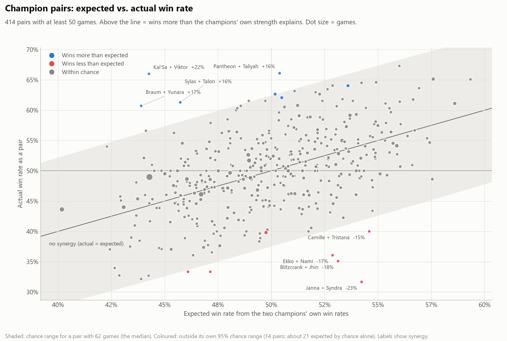
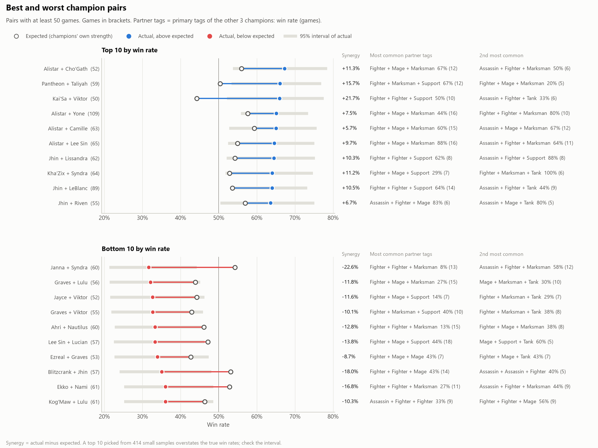

# Best and worst champion pairs and trios

**Question:** which groups of champions on the same team win the most and the least, and what are they usually played with?

**Data:** the same 10,000 NA Master+ ranked solo matches (20,000 teams) as the
[team composition analysis](../team_comps/README.md).

**Full results:** [top_bottom.md](top_bottom.md) has the top and bottom 10 pairs and trios, each with its two most common
**partner tags** (the primary tags of the team's other champions) and the win rate with each.

## Method

- A **group** is any 2 (pair) or 3 (trio) champions on the same team. Each team of 5 has 10 pairs and 10 trios.
- Groups are ranked by win rate, using only groups with at least **50 games for pairs** and **10 for trios**.
- **Synergy** = the group's win rate minus the rate expected from its champions' own win rates (their edges over 50%,
  added on the log-odds scale). For example, a 55% champion with a 50% champion is expected to win about 55% together. Positive synergy means the group
  wins more than its champions' individual strength explains.
- **Team share** = the share of all teams that had the group.

## Key findings

1. **Trios are too rare to rank yet.** Of 143,596 distinct trios, only 148 have 10 or more games, and the most common has 31.
   Only 7 of them have win rates outside what chance would produce, and 7 is exactly the number chance alone would give.
   The trio tables are there to show the method and to re-run with more data, not as results. Their partner-tag
   splits are only 1 to 6 games each.
2. **Pairs differ from 50%, but not from their champions' own strength.** 414 pairs have at least 50 games. 32 have win rates
   outside the chance range around 50%, against about 21 expected. But compared with what the two champions' own win rates predict, only
   **14 pairs beat or miss that by more than chance, fewer than the about 21 chance alone would give.** So the pairs at the top and bottom
   mostly reflect strong or weak champions plus luck, and there's no clear evidence of pair synergy in 10k matches.
3. **Alistar is in 4 of the top 10 pairs** because Alistar is strong in this data on its own (55.1% in 1,176 games).
   Alistar + Cho'Gath (+11 points) and Alistar + Lee Sin (+10) look better than expected, but neither is outside the chance range.
4. **The most common pairs are bot lanes, and they're below 50%:** Lulu + Yunara (390 games, 49.0%), Kai'Sa + Nautilus
   (232, 46.1%) and Ezreal + Karma (204, 43.6%).

## Charts

### Expected vs. actual win rate, every pair
Dots above the line win more than their champions' own strength explains. The shaded band is the chance range for a
pair with the median number of games (62); coloured pairs are outside their own chance range.


### Top and bottom 10 pairs
The hollow dot is the expected win rate and the filled dot the actual; the line between them is the synergy.
The columns on the right show the two most common partner-tag combos (the other 3 champions' primary tags) with win rate and games.


## Tables (`tables/`)

| File | Contents |
|---|---|
| `groups_size2.csv` / `groups_size3.csv` | Every pair/trio with at least the minimum games: games, wins, win rate, 95% interval, team share, expected win rate, synergy |
| `top_bottom_size2.csv` / `top_bottom_size3.csv` | Top and bottom 10, plus the 2 most common partner-tag combos with games and win rate |

## Reproduce

```
python analyze_team_comps.py          # builds the team table first
python analyze_champion_groups.py     # pairs and trios; --size 3 --min-games 15 to change
python plot_champion_groups.py        # the two pair charts
```
More matches would make the trio results usable. For the 148 trios that now have 10+ games to reach about 100 games each,
we'd need roughly 10 times more matches.
