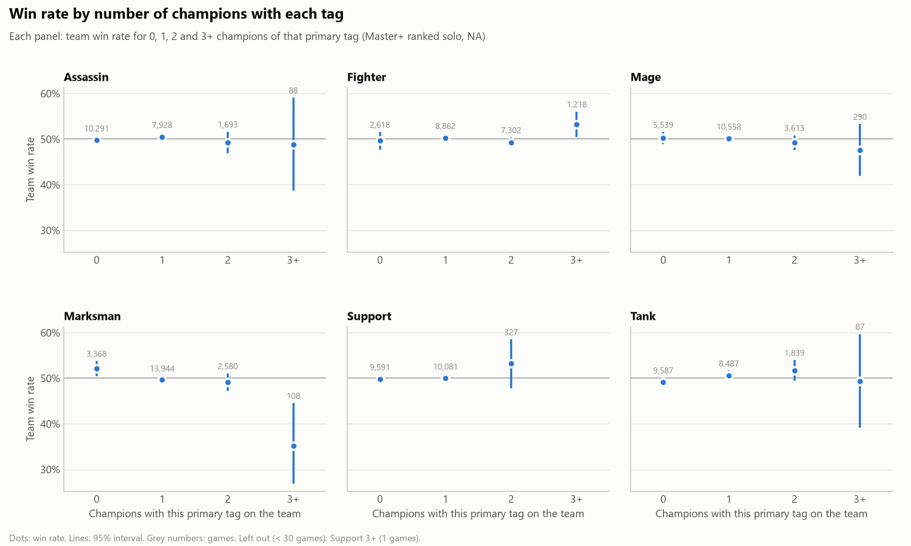
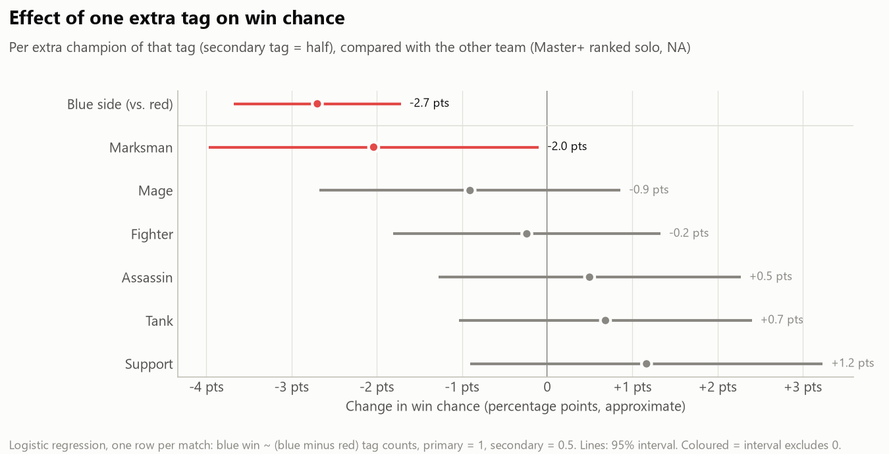
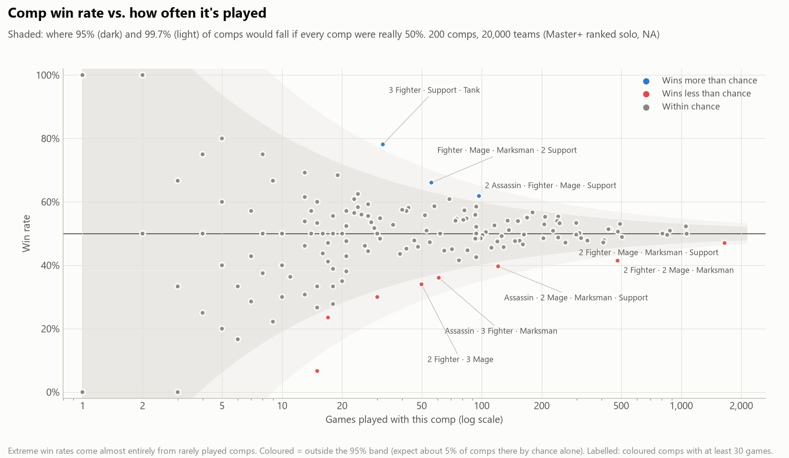
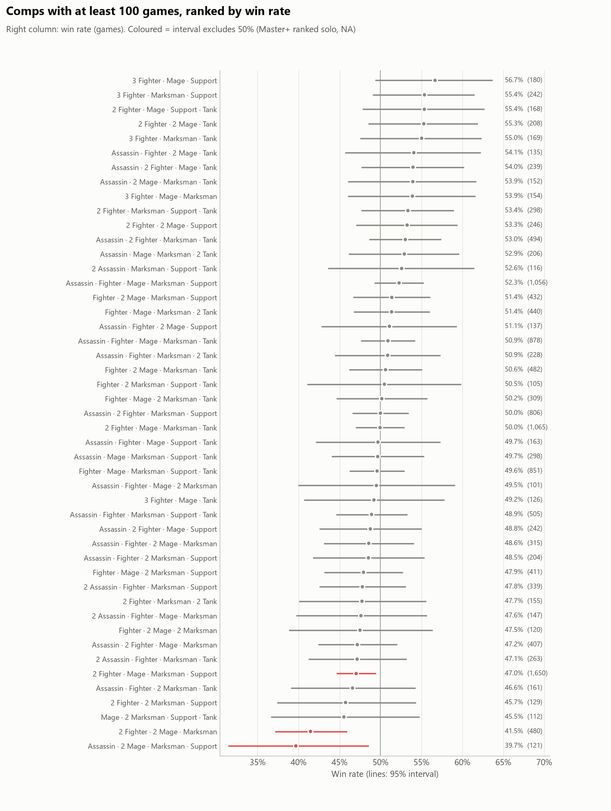
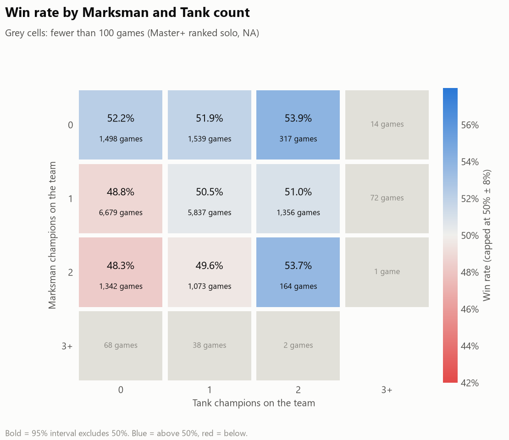
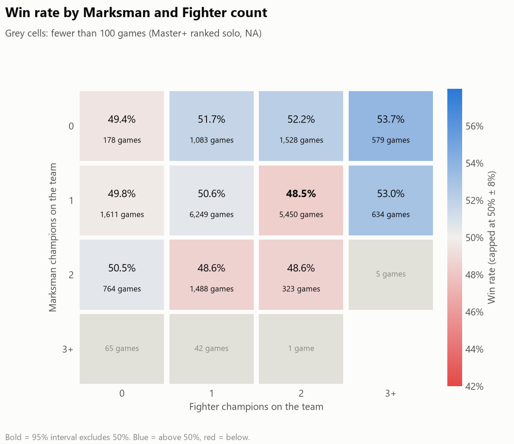
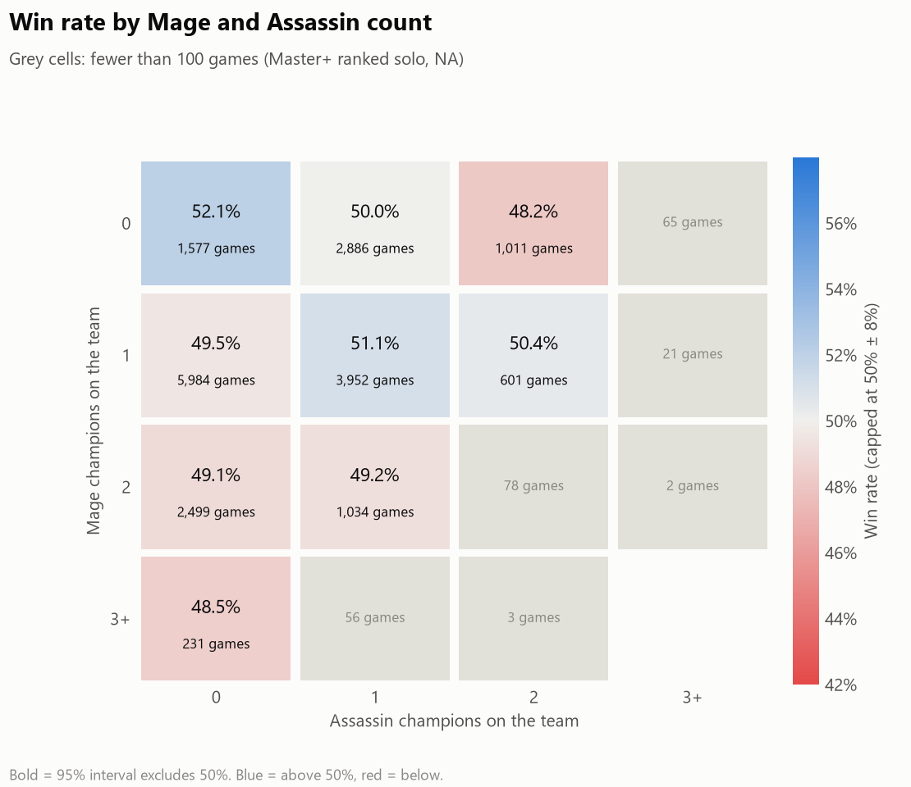

# Win rate by team composition (champion class tags)

**Question:** do some team compositions win more than others, judged by the champions' class tags?

**Data:** 10,000 ranked solo/duo matches from NA Master, Grandmaster and Challenger, 20 Oct to 3 Nov 2026
(patch 16.21, about 2% on 16.20). That gives 20,000 teams. Remakes are excluded.

**Method:** every champion has a primary tag and sometimes a secondary tag, from Riot's Data Dragon
(Assassin, Fighter, Mage, Marksman, Support, Tank). A team's **comp** is the count of its primary tags, for
example `2 Fighter · Mage · Marksman · Support`. Every chart shows 95% intervals, because almost every
effect is within a few points of 50%.

## Key findings

1. **Tags barely matter.** Most comps can't be told apart from a 50% win rate. Of the 47 comps with at least 100 games,
   only 3 clearly differ from 50%, and all three are below it.
2. **Stacking marksmen is the clearest effect.** Teams with no marksman win 52.1%, teams with 3 or more win 35%
   (only 108 games). Each extra marksman lowers win chance by about 2 points, and that's the only tag effect that clearly differs from zero.
3. **Map side is the biggest effect of all.** Red side wins 52.7%. That's bigger than any tag effect.
4. **A second marksman is only bad without tanks.** Two marksmen with no tank win 48.3%, with two tanks 53.7%
   (164 games, so this is suggestive only).

## Charts

### Win rate by number of champions with each tag


### Effect of one extra tag on win chance
Each match is one data point: blue's win against the difference in tag counts between blue and red
(primary tag = 1, secondary tag = 0.5). This way the two teams in a match aren't counted as independent samples.


### Comp win rate vs. how often it's played
The shaded band is where comps would fall if every comp were really 50%. Most extreme win rates
come from comps that are rarely played.


### Comps with at least 100 games, ranked


### Two tags at once




## Tables (`tables/`)

| File | Contents |
|---|---|
| `comp_winrates.csv` | Every comp: games, wins, win rate, 95% interval, pick share |
| `tag_count_winrates.csv` | Win rate by tag and count (0, 1, 2, 3+) |
| `matchup_winrates.csv` | Comp vs. comp (at least 30 games; sparse) |
| `tag_regression.csv` | Logistic regression coefficients, standard errors, p-values |

## Caveats

- Tags are broad. "Mage" covers both Lux support and Kassadin mid, and roles aren't used.
- Champion tags come from Data Dragon 16.22.1, but the matches are from 16.21. Tags rarely change between patches.
- Each match's tier is the tier of the player it was found through, so it's approximate.

## Reproduce

```
python analyze_team_comps.py     # tables (needs the match crawl and champion tables)
python plot_team_comps.py        # charts
```
Options: `--tier CHALLENGER`, `--patch 16.21`, `--min-games 100`, `--heatmaps Tank:Support`.
